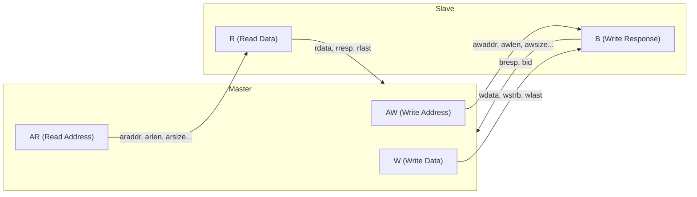
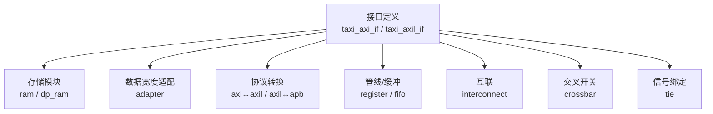
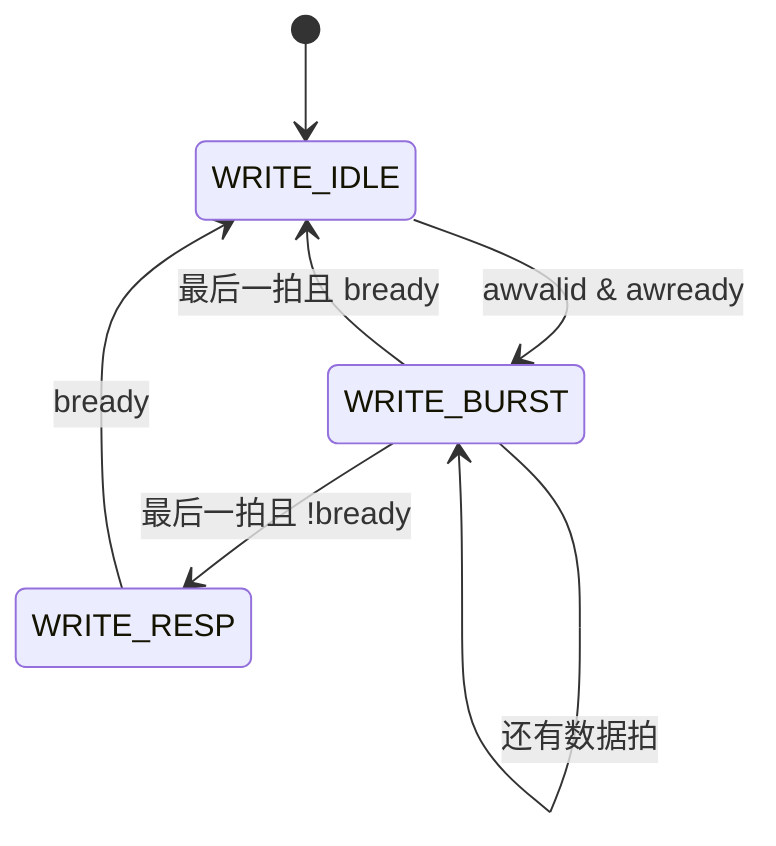
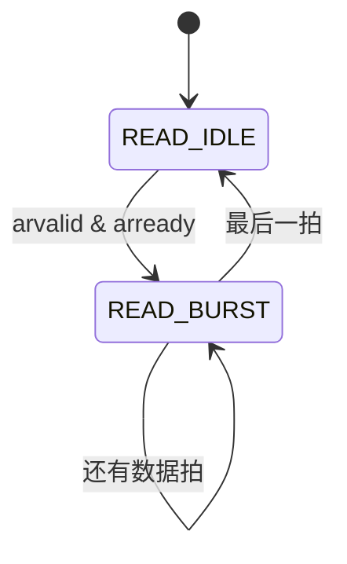
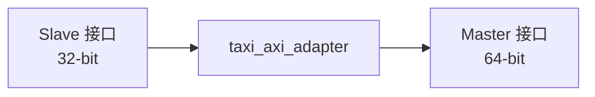
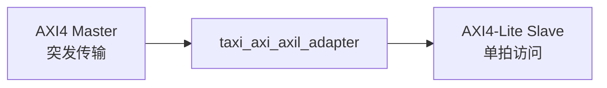
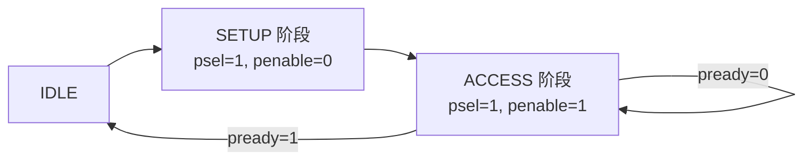
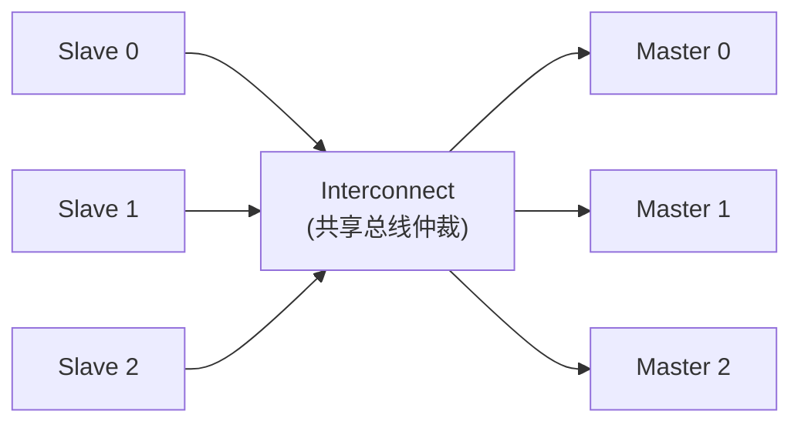
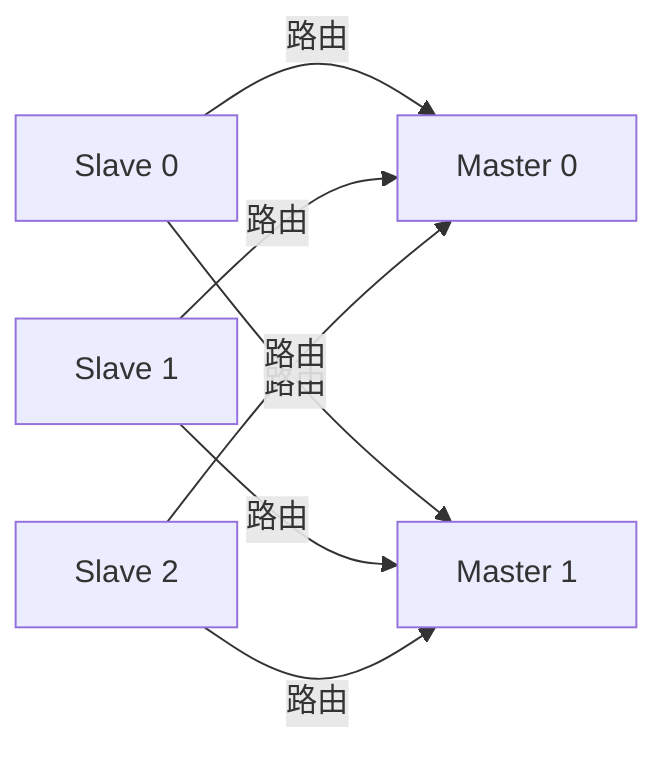
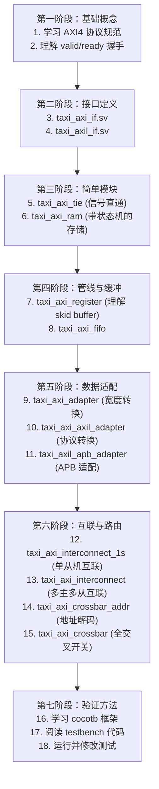

# Taxi AXI 模块库学习指南

> 完整学习 `/home/chenye/learning/taxi/src/axi` 下的 AXI/AXI-Lite/APB 总线基础设施代码库

## 目录

1. [项目概览](#1-项目概览)
2. [AXI 协议基础回顾](#2-axi-协议基础回顾)
3. [环境搭建与工具链](#3-环境搭建与工具链)
4. [核心接口定义 (Interface)](#4-核心接口定义-interface)
5. [模块分类与架构总览](#5-模块分类与架构总览)
6. [逐模块详解](#6-逐模块详解)
   - [6.1 存储模块 (RAM)](#61-存储模块-ram)
   - [6.2 数据宽度适配器 (Adapter)](#62-数据宽度适配器-adapter)
   - [6.3 协议转换器](#63-协议转换器)
   - [6.4 管线与缓冲 (Register / FIFO)](#64-管线与缓冲-register--fifo)
   - [6.5 互联模块 (Interconnect)](#65-互联模块-interconnect)
   - [6.6 交叉开关 (Crossbar)](#66-交叉开关-crossbar)
   - [6.7 信号绑定 (Tie)](#67-信号绑定-tie)
7. [设计模式与代码风格](#7-设计模式与代码风格)
8. [Testbench 体系 (cocotb)](#8-testbench-体系-cocotb)
9. [动手实验：运行仿真](#9-动手实验运行仿真)
10. [学习路径建议](#10-学习路径建议)

---

## 1. 项目概览

**Taxi AXI** 是由 FPGA Ninja（Alex Forencich）开发的一套高质量、可参数化的 AXI 总线基础设施 IP 库。整个代码库使用 **SystemVerilog** 编写，遵循 CERN-OHL-S-2.0 / MIT 开源许可。

### 文件统计

| 类别 | 文件数 | 说明 |
|------|--------|------|
| RTL 源文件 (`.sv`) | 64 | 包括接口定义、顶层模块、读写子模块 |
| 文件列表 (`.f`) | ~30 | Verilator/仿真器源文件列表 |
| Testbench (`.py`) | 20 | cocotb Python 测试 |
| Testbench (`.sv`) | 20 | 仿真顶层模块 |
| Makefile | 20 | 仿真构建配置 |

### 目录结构

```
src/axi/
├── rtl/                      # RTL 源文件
│   ├── taxi_axi_if.sv        # ★ AXI4 接口定义
│   ├── taxi_axil_if.sv       # ★ AXI4-Lite 接口定义
│   ├── taxi_axi_*.sv         # AXI4 相关模块
│   ├── taxi_axil_*.sv        # AXI4-Lite 相关模块
│   └── *.f                   # 文件列表（用于仿真器）
└── tb/                       # Testbench 目录
    ├── taxi_axi_ram/          # AXI RAM 测试
    ├── taxi_axi_crossbar/     # 交叉开关测试
    ├── taxi_axi_adapter/      # 适配器测试
    └── ...                    # 其他模块的测试
```

---

## 2. AXI 协议基础回顾

在深入代码之前，快速回顾 AXI 协议的核心概念：

### AXI4 五通道架构



### AXI4 vs AXI4-Lite 对比

| 特性 | AXI4 | AXI4-Lite |
|------|------|-----------|
| 突发传输 (Burst) | ✅ 支持（最多 256 拍） | ❌ 仅单拍 |
| 事务 ID | ✅ 支持（乱序完成） | ❌ 不支持 |
| 信号 `awlen/arlen` | ✅ 0~255 | ❌ 无 |
| 信号 `awsize/arsize` | ✅ 可变宽度 | ❌ 固定 |
| 信号 `wlast/rlast` | ✅ 标记最后一拍 | ❌ 无 |
| 信号 `awid/arid` | ✅ 事务标签 | ❌ 无 |
| 典型用途 | 高带宽数据传输 | 寄存器配置访问 |

### Valid/Ready 握手

AXI 的所有五个通道都使用 **valid/ready** 握手机制：

- **发送方**置 `valid = 1`，数据有效
- **接收方**置 `ready = 1`，可以接收
- 传输发生在 `valid && ready` 同时为高的时钟上升沿

> [!IMPORTANT]
> AXI 规范规定：`valid` 一旦拉高，**不可在 `ready` 拉高之前撤销**。但 `ready` 可以随时变化。

---

## 3. 环境搭建与工具链

### 必需工具

| 工具 | 用途 | 安装命令 |
|------|------|----------|
| **Verilator** | RTL 仿真器（首选） | `sudo apt install verilator` |
| **Icarus Verilog** | 备选仿真器 | `sudo apt install iverilog` |
| **Python 3.8+** | cocotb 运行环境 | 系统自带 |
| **cocotb** | Python 协同仿真框架 | `pip install cocotb` |
| **cocotb-test** | pytest 集成 | `pip install cocotb-test` |
| **cocotbext-axi** | AXI 总线功能模型 (BFM) | `pip install cocotbext-axi` |

### 安装步骤

```bash
# 1. 创建 Python 虚拟环境（推荐）
cd /home/chenye/learning/taxi
python3 -m venv .venv
source .venv/bin/activate

# 2. 安装 cocotb 工具链
pip install cocotb cocotb-test cocotbext-axi

# 3. 验证安装
cocotb-config --version
verilator --version
```

> [!TIP]
> 本项目的所有 Makefile 默认使用 `SIM=verilator`。如需切换到 Icarus Verilog，运行仿真时传入 `SIM=icarus`。

---

## 4. 核心接口定义 (Interface)

这是整个代码库的**基石**，所有模块的端口都通过这两个 SystemVerilog `interface` 连接。

### 4.1 `taxi_axi_if` — 完整 AXI4 接口

📄 [taxi_axi_if.sv](file:///home/chenye/learning/taxi/src/axi/rtl/taxi_axi_if.sv)

```systemverilog
interface taxi_axi_if #(
    parameter DATA_W = 32,          // 数据总线宽度
    parameter ADDR_W = 32,          // 地址总线宽度
    parameter STRB_W = (DATA_W/8),  // 写字节使能宽度
    parameter ID_W = 8,             // 事务 ID 宽度
    parameter logic AWUSER_EN = 1'b0, // AW 通道 user 信号使能
    parameter AWUSER_W = 1,
    // ... 类似的 WUSER, BUSER, ARUSER, RUSER 参数
    parameter MAX_BURST_LEN = 256,     // 最大突发长度
    parameter logic NARROW_BURST_EN = 1'b1  // 是否支持窄突发
) ();
```

**6 个 Modport 视角：**

| Modport | 方向 | 用途 |
|---------|------|------|
| `wr_mst` | 写主机 | AW/W 输出、B 输入 |
| `wr_slv` | 写从机 | AW/W 输入、B 输出 |
| `rd_mst` | 读主机 | AR 输出、R 输入 |
| `rd_slv` | 读从机 | AR 输入、R 输出 |
| `wr_mon` | 写监视 | 所有写通道信号均为输入 |
| `rd_mon` | 读监视 | 所有读通道信号均为输入 |

> [!NOTE]
> **关键设计决策**：读写通道使用**独立的 modport**（`wr_mst`/`rd_mst` 而非统一的 `mst`）。这使得模块可以只绑定需要的通道，例如 RAM 模块分别通过 `wr_slv` 和 `rd_slv` 接入写和读接口。

### 4.2 `taxi_axil_if` — AXI4-Lite 接口

📄 [taxi_axil_if.sv](file:///home/chenye/learning/taxi/src/axi/rtl/taxi_axil_if.sv)

```systemverilog
interface taxi_axil_if #(
    parameter DATA_W = 32,
    parameter ADDR_W = 32,
    parameter STRB_W = (DATA_W/8),
    // user 信号参数 (AWUSER, WUSER, BUSER, ARUSER, RUSER)
) ();
```

与 `taxi_axi_if` 的主要区别：
- ❌ 没有 `ID_W`（无事务 ID）
- ❌ 没有 `awlen/arlen, awsize/arsize, awburst/arburst`（无突发控制）
- ❌ 没有 `awlock, awcache, awqos, awregion`
- ❌ 没有 `wlast, rlast`
- ✅ 保留了 `awprot/arprot`（保护属性）
- ✅ 相同的 6 个 modport 结构

---

## 5. 模块分类与架构总览

整个代码库的模块可以按功能分为以下 7 大类：



### 命名约定

本代码库遵循严格的命名规则：

| 前缀 | 含义 |
|------|------|
| `taxi_axi_*` | AXI4 全功能模块 |
| `taxi_axil_*` | AXI4-Lite 模块 |
| `*_rd` 后缀 | 读通道子模块 |
| `*_wr` 后缀 | 写通道子模块 |
| `*_1s` 后缀 | 单从机 (1-Slave) 优化版本 |
| `*_addr` 后缀 | 地址解码子模块 |

### 读写分离架构

> [!IMPORTANT]
> **贯穿全库的核心设计模式**：几乎所有顶层模块都将读通道和写通道拆分为独立的子模块（`*_rd` 和 `*_wr`），然后在顶层模块中组合。
>
> 例如 `taxi_axi_crossbar` 内部实例化了 `taxi_axi_crossbar_wr` 和 `taxi_axi_crossbar_rd`。
>
> 这种设计确保了**读写通道的完全独立**，避免互相阻塞。

---

## 6. 逐模块详解

### 6.1 存储模块 (RAM)

#### `taxi_axi_ram` — AXI4 块 RAM

📄 [taxi_axi_ram.sv](file:///home/chenye/learning/taxi/src/axi/rtl/taxi_axi_ram.sv)

**功能**：实现一个带 AXI4 从机接口的块 RAM 存储器。

**参数**：

| 参数 | 默认值 | 说明 |
|------|--------|------|
| `ADDR_W` | 16 | 地址宽度（决定 RAM 大小） |
| `PIPELINE_OUTPUT` | 0 | 是否在读数据输出加流水线寄存器 |

**内部状态机**：

写通道 FSM：


读通道 FSM：


**关键实现细节**：

1. **字节使能写入**：通过 `wstrb` 实现按字节粒度写入
   ```systemverilog
   for (integer i = 0; i < BYTE_LANES; i = i + 1) begin
       if (mem_wr_en & s_axi_wr.wstrb[i]) begin
           mem[write_addr_valid][BYTE_W*i +: BYTE_W] <= s_axi_wr.wdata[BYTE_W*i +: BYTE_W];
       end
   end
   ```

2. **地址递增**：支持固定（`FIXED=2'b00`）和递增（`INCR=2'b01`）突发类型
   ```systemverilog
   if (write_burst_reg != 2'b00) begin
       write_addr_next = write_addr_reg + (1 << write_size_reg);
   end
   ```

3. **可选流水线输出**：`PIPELINE_OUTPUT` 参数可插入额外寄存器级改善时序

#### `taxi_axi_dp_ram` — AXI4 双端口 RAM

📄 [taxi_axi_dp_ram.sv](file:///home/chenye/learning/taxi/src/axi/rtl/taxi_axi_dp_ram.sv)

**功能**：真双端口 RAM，两个独立 AXI4 接口可同时读写同一存储空间。

**特点**：
- 支持**独立时钟域**（`a_clk` / `b_clk`）
- 通过 `taxi_axi_ram_if_rdwr` 将 AXI 突发协议转换为简单 RAM 命令
- 可选的**读写交织** (`A_INTERLEAVE` / `B_INTERLEAVE`)
- 可选的**输出流水线** (`A_PIPELINE_OUTPUT` / `B_PIPELINE_OUTPUT`)

#### `taxi_axil_ram` / `taxi_axil_dp_ram` — AXI4-Lite RAM

AXI4-Lite 版本的 RAM 和双端口 RAM，接口简化（无突发、无 ID），适用于寄存器空间仿真。

---

### 6.2 数据宽度适配器 (Adapter)

#### `taxi_axi_adapter` — AXI4 数据宽度适配

📄 [taxi_axi_adapter.sv](file:///home/chenye/learning/taxi/src/axi/rtl/taxi_axi_adapter.sv)

**功能**：在不同数据宽度的 AXI4 接口之间进行转换。



**参数**：

| 参数 | 默认值 | 说明 |
|------|--------|------|
| `CONVERT_BURST` | 1 | 适配到更宽总线时，重新打包全宽突发 |
| `CONVERT_NARROW_BURST` | 0 | 适配到更宽总线时，重新打包所有突发（包括窄突发） |

**工作原理**：
- **上调 (upsize)**：窄 → 宽。多个窄拍打包为一个宽拍
- **下调 (downsize)**：宽 → 窄。一个宽拍拆分为多个窄拍
- 自动推导宽度参数（从接口实例获取 `DATA_W`）

#### `taxi_axil_adapter` — AXI4-Lite 数据宽度适配

类似功能，但处理的是 AXI4-Lite 单拍传输的宽度转换。在下调模式中，一个宽的 AXI-Lite 传输被分解为多个窄传输；在上调模式中，窄传输被映射到宽总线的对应字节通道。

---

### 6.3 协议转换器

#### `taxi_axi_axil_adapter` — AXI4 → AXI4-Lite

📄 [taxi_axi_axil_adapter.sv](file:///home/chenye/learning/taxi/src/axi/rtl/taxi_axi_axil_adapter.sv)

**功能**：将 AXI4 突发事务转换为 AXI4-Lite 单拍操作。



**关键行为**：
- 一个 `awlen=N` 的突发写被拆分为 N+1 次 AXI-Lite 写
- 维护事务 ID（`awid/arid`）以构建正确的响应
- 聚合子事务的错误响应（任意子事务出 SLVERR 则最终响应为 SLVERR）
- 同时处理数据宽度转换

#### `taxi_axil_axi_adapter` — AXI4-Lite → AXI4

📄 [taxi_axil_axi_adapter.sv](file:///home/chenye/learning/taxi/src/axi/rtl/taxi_axil_axi_adapter.sv)

**功能**：反向转换，将 AXI-Lite 单拍封装为 AXI4 格式（`awlen=0, awburst=INCR, wlast=1`）。

#### `taxi_axil_apb_adapter` — AXI4-Lite → APB

📄 [taxi_axil_apb_adapter.sv](file:///home/chenye/learning/taxi/src/axi/rtl/taxi_axil_apb_adapter.sv)

**功能**：将 AXI4-Lite 事务转换为 APB（高级外设总线）协议访问。

**APB 协议时序**（两阶段访问）：


**三种数据宽度模式**（通过 `generate` 块选择）：

| 模式 | 条件 | 行为 |
|------|------|------|
| `translate` | APB宽度 = AXI-Lite宽度 | 直接映射 |
| `upsize` | APB宽度 > AXI-Lite宽度 | 窄数据复制到宽总线，strobe 定位 |
| `downsize` | APB宽度 < AXI-Lite宽度 | 多段顺序 APB 访问 |

---

### 6.4 管线与缓冲 (Register / FIFO)

#### `taxi_axi_register` — AXI4 寄存器缓冲

📄 [taxi_axi_register.sv](file:///home/chenye/learning/taxi/src/axi/rtl/taxi_axi_register.sv)

**功能**：在 AXI4 路径上插入可配置的流水线寄存器，断开时序路径。

**每通道独立的寄存器类型**：

| 类型值 | 名称 | 行为 | 吞吐率 |
|--------|------|------|--------|
| 0 | Bypass | 直通（组合逻辑） | 100% 但不断路 |
| 1 | Simple Buffer | 单级寄存器 | <100%（有气泡） |
| 2 | Skid Buffer | 双级缓冲 | 100%（无气泡） |

**默认配置**：
- AW/AR/B: Simple Buffer (1) — 地址和响应通道通常非瓶颈
- W/R: Skid Buffer (2) — 数据通道需要全吞吐

> [!TIP]
> **Skid Buffer** 是 AXI 设计中的核心组件。它通过维护两级存储，使得即使下游在某个周期不能接受数据（`ready=0`），上游的数据也不会丢失，从而实现真正的零气泡全速传输。

#### `taxi_axi_fifo` — AXI4 FIFO 缓冲

📄 [taxi_axi_fifo.sv](file:///home/chenye/learning/taxi/src/axi/rtl/taxi_axi_fifo.sv)

**功能**：在写通道和读通道各插入 FIFO，解耦主从接口的时序压力。

**参数**：

| 参数 | 默认值 | 说明 |
|------|--------|------|
| `WRITE_FIFO_DEPTH` | 32 | 写 FIFO 深度 |
| `READ_FIFO_DEPTH` | 32 | 读 FIFO 深度 |
| `WRITE_FIFO_DELAY` | 0 | 1 = AW 等到整个突发数据入 FIFO 后才发出 |
| `READ_FIFO_DELAY` | 0 | 1 = AR 等到 FIFO 有足够空间后才发出 |

> [!NOTE]
> `WRITE_FIFO_DELAY=1` 可以防止 AW 通道先于 W 数据抵达，避免下游互联组件死锁。这在跨时钟域或深管线系统中尤为重要。

#### AXI4-Lite 版本

- `taxi_axil_register`：同样的三种寄存器类型，但只有 AW/W/B/AR/R 五通道（无 ID/突发信号）

---

### 6.5 互联模块 (Interconnect)

#### `taxi_axi_interconnect` — AXI4 共享总线互联

📄 [taxi_axi_interconnect.sv](file:///home/chenye/learning/taxi/src/axi/rtl/taxi_axi_interconnect.sv)

**功能**：M:N 多主机到多从机的 AXI4 共享总线互联。



**参数**：

| 参数 | 说明 |
|------|------|
| `S_COUNT` | 从机接口数量（即主设备个数） |
| `M_COUNT` | 主机接口数量（即从设备个数） |
| `M_REGIONS` | 每个主机接口的地址区域数 |
| `M_BASE_ADDR` | 主机接口基地址 |
| `M_ADDR_W` | 主机接口地址宽度（决定地址范围大小） |
| `M_CONNECT_RD/WR` | 读/写连接矩阵（位掩码） |
| `M_SECURE` | 安全主机标志 |

**vs Crossbar 的区别**：
- Interconnect 使用**共享总线 + 仲裁器**，同一时刻只有一对主从在通信
- 资源占用更少，但**带宽受限**
- 适用于低竞争场景

#### `taxi_axi_interconnect_1s` — 单从机互联

📄 [taxi_axi_interconnect_1s.sv](file:///home/chenye/learning/taxi/src/axi/rtl/taxi_axi_interconnect_1s.sv)

**功能**：1 个从机（主设备）扇出到 N 个主机（从设备）的优化版本。

- 省去了从机侧仲裁逻辑
- 仅做地址解码和路由
- **典型用途**：CPU → 多外设的地址译码器

---

### 6.6 交叉开关 (Crossbar)

#### `taxi_axi_crossbar` — AXI4 全交叉开关

📄 [taxi_axi_crossbar.sv](file:///home/chenye/learning/taxi/src/axi/rtl/taxi_axi_crossbar.sv)

**功能**：M×N 全互联交叉开关，支持**多对主从并行通信**。



**丰富的参数化**：

| 参数 | 说明 |
|------|------|
| `S_THREADS` | 每个从机支持的并发唯一 ID 数 |
| `S_ACCEPT` | 每个从机支持的并发事务数 |
| `M_ISSUE` | 每个主机的并发发出数 |
| `M_REGIONS` | 每个主机的地址区域数（最多 16） |
| `S_AW/W/B/AR/R_REG_TYPE` | 从机侧各通道寄存器类型 |
| `M_AW/W/B/AR/R_REG_TYPE` | 主机侧各通道寄存器类型 |

#### `taxi_axi_crossbar_addr` — 地址解码与准入控制

📄 [taxi_axi_crossbar_addr.sv](file:///home/chenye/learning/taxi/src/axi/rtl/taxi_axi_crossbar_addr.sv)

这是交叉开关的**核心子模块**，实现：

1. **地址解码**：将事务地址与 `M_BASE_ADDR` / `M_ADDR_W` 匹配
2. **连接性检查**：验证 `M_CONNECT` 矩阵允许该路径
3. **安全检查**：验证 `awprot/arprot` 与 `M_SECURE` 一致
4. **ID 线程追踪**：同一 ID 的事务必须路由到同一目标
5. **事务限流**：通过 `S_ACCEPT` 限制未完成事务数量

**线程追踪机制**：
```systemverilog
// 每个线程维护: ID、目标主机、区域、计数
logic [ID_W-1:0]  thread_id_reg[S_INT_THREADS-1:0];
logic [SEL_W-1:0] thread_m_reg[S_INT_THREADS-1:0];
logic [3:0]       thread_region_reg[S_INT_THREADS-1:0];
logic [$clog2(S_ACCEPT+1)-1:0] thread_count_reg[S_INT_THREADS-1:0];
```

> [!WARNING]
> `S_THREADS` 和 `S_ACCEPT` 的配置直接影响交叉开关的行为：
> - `S_THREADS` 过小会导致不同 ID 的事务被序列化
> - `S_ACCEPT` 过小会限制管线深度和吞吐量
> - `S_THREADS > S_ACCEPT` 时会被自动限制为 `S_ACCEPT`

#### `taxi_axi_crossbar_1s` — 单从机交叉开关

📄 [taxi_axi_crossbar_1s.sv](file:///home/chenye/learning/taxi/src/axi/rtl/taxi_axi_crossbar_1s.sv)

单从机优化版本，省去了从机侧仲裁器和连接矩阵，保留了完整的地址解码、ID 追踪和事务限流。

#### AXI4-Lite Crossbar/Interconnect

AXI4-Lite 版本的交叉开关和互联模块功能类似，但因为没有 ID 和突发，实现更为简单。

---

### 6.7 信号绑定 (Tie)

#### `taxi_axi_tie` — AXI4 信号直通

📄 [taxi_axi_tie.sv](file:///home/chenye/learning/taxi/src/axi/rtl/taxi_axi_tie.sv)

**功能**：将 AXI4 从机接口信号直接连接到主机接口，无寄存器延迟。

**用途**：
- 参数适配（地址宽度裁剪、user 信号处理）
- 编译期检查 `DATA_W` 和 `STRB_W` 匹配
- user 信号的条件路由（使能时传递，禁用时置零）

---

## 7. 设计模式与代码风格

通过阅读整个代码库，可以总结出以下一致的设计模式：

### 7.1 两阶段组合/时序分离

```systemverilog
// 组合逻辑：计算下一状态
always_comb begin
    state_next = state_reg;
    signal_next = signal_reg;
    // ... 状态转移逻辑
end

// 时序逻辑：寄存状态
always_ff @(posedge clk) begin
    state_reg <= state_next;
    signal_reg <= signal_next;
    if (rst) begin
        state_reg <= STATE_IDLE;
    end
end
```

> [!TIP]
> 注意复位信号的处理方式：**同步复位**，放在 `always_ff` 块的最后（优先级最高）。这是 FPGA 友好的复位风格。

### 7.2 参数从接口实例提取

```systemverilog
// 不在模块参数声明数据宽度，而是从接口实例中提取
localparam DATA_W = s_axi_wr.DATA_W;
localparam STRB_W = s_axi_wr.STRB_W;
```

这样做的好处：**消除参数冗余**，接口定义是唯一的配置源。

### 7.3 编译期检查

```systemverilog
// 使用 $fatal 在编译/elaboration 时捕获配置错误
if (BYTE_W * STRB_W != DATA_W)
    $fatal(0, "Error: AXI data width not evenly divisible (instance %m)");
```

### 7.4 `generate` 块条件实例化

```systemverilog
if (APB_BYTE_LANES == AXIL_BYTE_LANES) begin : translate
    // 同宽度：直接翻译
end else if (APB_BYTE_LANES > AXIL_BYTE_LANES) begin : upsize
    // 上调
end else begin : downsize
    // 下调
end
```

### 7.5 文件头规范

```systemverilog
`resetall           // 重置所有编译器指令
`timescale 1ns / 1ps
`default_nettype none  // 要求所有线网必须声明
// ... 模块定义 ...
`resetall           // 文件末尾再次重置
```

---

## 8. Testbench 体系 (cocotb)

### 8.1 测试架构

每个模块的测试由三个文件组成：

| 文件 | 作用 |
|------|------|
| `test_taxi_*.sv` | SystemVerilog 仿真顶层（实例化 DUT 和接口） |
| `test_taxi_*.py` | cocotb Python 测试用例 |
| `Makefile` | 仿真构建配置 |

### 8.2 典型测试结构

📄 [test_taxi_axi_ram.py](file:///home/chenye/learning/taxi/src/axi/tb/taxi_axi_ram/test_taxi_axi_ram.py)

```python
class TB(object):
    def __init__(self, dut):
        self.dut = dut
        # 启动时钟
        cocotb.start_soon(Clock(dut.clk, 10, units="ns").start())
        # 创建 AXI Master BFM
        self.axi_master = AxiMaster(AxiBus.from_entity(dut.s_axi), dut.clk, dut.rst)

    def set_idle_generator(self, generator=None):
        """设置空闲插入器（模拟主机暂停）"""
        if generator:
            self.axi_master.write_if.aw_channel.set_pause_generator(generator())
            self.axi_master.write_if.w_channel.set_pause_generator(generator())
            self.axi_master.read_if.ar_channel.set_pause_generator(generator())

    def set_backpressure_generator(self, generator=None):
        """设置背压生成器（模拟从机不就绪）"""
        if generator:
            self.axi_master.write_if.b_channel.set_pause_generator(generator())
            self.axi_master.read_if.r_channel.set_pause_generator(generator())

    async def cycle_reset(self):
        """执行复位序列"""
        self.dut.rst.setimmediatevalue(0)
        await RisingEdge(self.dut.clk)
        await RisingEdge(self.dut.clk)
        self.dut.rst.value = 1
        await RisingEdge(self.dut.clk)
        await RisingEdge(self.dut.clk)
        self.dut.rst.value = 0
        await RisingEdge(self.dut.clk)
        await RisingEdge(self.dut.clk)
```

### 8.3 测试类型

| 测试函数 | 验证内容 |
|----------|----------|
| `run_test_write` | 各种长度、偏移、突发大小的写操作 |
| `run_test_read` | 各种长度、偏移、突发大小的读操作 |
| `run_stress_test` | 16 个并发协程的随机读写压力测试 |

### 8.4 参数化测试

```python
@cocotb.test()
@cocotb.parametrize(
    ("idle_inserter", [None, cycle_pause]),       # 有/无空闲插入
    ("backpressure_inserter", [None, cycle_pause]), # 有/无背压
    ("size", [None]+list(range(max_burst_size))),  # 各种突发大小
)
async def run_test_write(dut, idle_inserter=None, backpressure_inserter=None, size=None):
    ...
```

### 8.5 pytest 集成

```python
@pytest.mark.parametrize("data_w", [8, 16, 32])
def test_taxi_axi_ram(request, data_w):
    cocotb_test.simulator.run(
        simulator="verilator",
        verilog_sources=verilog_sources,
        toplevel=toplevel,
        module=module,
        parameters=parameters,
        sim_build=sim_build,
    )
```

### 8.6 仿真顶层模块

📄 [test_taxi_axi_ram.sv](file:///home/chenye/learning/taxi/src/axi/tb/taxi_axi_ram/test_taxi_axi_ram.sv)

```systemverilog
module test_taxi_axi_ram #(
    parameter DATA_W = 32,
    parameter ADDR_W = 16,
    parameter STRB_W = (DATA_W/8),
    parameter ID_W = 8,
    parameter PIPELINE_OUTPUT = 0
) ();

logic clk;
logic rst;

// 实例化 AXI 接口
taxi_axi_if #(
    .DATA_W(DATA_W),
    .ADDR_W(ADDR_W+16),
    .STRB_W(STRB_W),
    .ID_W(ID_W)
) s_axi();

// 实例化被测模块
taxi_axi_ram #(
    .ADDR_W(ADDR_W),
    .PIPELINE_OUTPUT(PIPELINE_OUTPUT)
) uut (
    .clk(clk),
    .rst(rst),
    .s_axi_wr(s_axi),
    .s_axi_rd(s_axi)
);
endmodule
```

> [!NOTE]
> 注意接口的 `ADDR_W` 设为 `ADDR_W+16`，比 RAM 实际的地址宽度大。这是为了测试 RAM 模块对高位地址的截断处理。

---

## 9. 动手实验：运行仿真

### 实验 1：运行 AXI RAM 测试

```bash
# 激活虚拟环境
source /home/chenye/learning/taxi/.venv/bin/activate

# 进入测试目录
cd /home/chenye/learning/taxi/src/axi/tb/taxi_axi_ram

# 使用 Makefile 运行（Verilator）
make SIM=verilator

# 或使用 pytest 运行多参数测试
pytest test_taxi_axi_ram.py -v
```

### 实验 2：运行交叉开关测试

```bash
cd /home/chenye/learning/taxi/src/axi/tb/taxi_axi_crossbar
make SIM=verilator
```

### 实验 3：查看波形

```bash
# 启用波形记录
make SIM=verilator WAVES=1

# 使用 GTKWave 查看（需要另外安装）
gtkwave sim_build/dump.fst
```

### 实验 4：修改参数重新仿真

```bash
# 修改数据宽度为 64 位
make SIM=verilator PARAM_DATA_W=64 PARAM_STRB_W=8
```

---

## 10. 学习路径建议

按照以下顺序循序渐进地学习本代码库：



### 每个阶段的学习目标

| 阶段 | 目标 | 关键问题 |
|------|------|----------|
| 1 | 掌握协议基础 | valid/ready 什么时候能撤销？突发如何编址？ |
| 2 | 理解接口抽象 | 为什么读写用独立 modport？user 信号的用途？ |
| 3 | 掌握状态机编写 | 写 FSM 和读 FSM 为什么独立？字节使能如何工作？ |
| 4 | 理解时序优化 | bypass vs simple vs skid buffer 的吞吐量差异？ |
| 5 | 掌握宽度转换 | 窄→宽如何打包？宽→窄如何拆分和编址？ |
| 6 | 理解总线互联 | interconnect vs crossbar 的资源/性能权衡？ |
| 7 | 掌握验证方法 | 如何用 cocotb 编写参数化测试？ |

> [!TIP]
> 建议每学完一个模块后，到对应的 `tb/` 目录下运行测试，观察波形，加深理解。可以尝试修改参数（如 `DATA_W`）重新仿真，观察行为变化。

---

## 附录：完整模块速查表

### AXI4 模块

| 模块 | 功能 | 关键参数 |
|------|------|----------|
| [taxi_axi_if](file:///home/chenye/learning/taxi/src/axi/rtl/taxi_axi_if.sv) | AXI4 接口定义 | `DATA_W, ADDR_W, ID_W` |
| [taxi_axi_ram](file:///home/chenye/learning/taxi/src/axi/rtl/taxi_axi_ram.sv) | AXI4 块 RAM | `ADDR_W, PIPELINE_OUTPUT` |
| [taxi_axi_dp_ram](file:///home/chenye/learning/taxi/src/axi/rtl/taxi_axi_dp_ram.sv) | AXI4 双端口 RAM | `ADDR_W, A/B_PIPELINE_OUTPUT, A/B_INTERLEAVE` |
| [taxi_axi_adapter](file:///home/chenye/learning/taxi/src/axi/rtl/taxi_axi_adapter.sv) | 数据宽度适配 | `CONVERT_BURST, CONVERT_NARROW_BURST` |
| [taxi_axi_register](file:///home/chenye/learning/taxi/src/axi/rtl/taxi_axi_register.sv) | 管线寄存器 | `AW/W/B/AR/R_REG_TYPE` |
| [taxi_axi_fifo](file:///home/chenye/learning/taxi/src/axi/rtl/taxi_axi_fifo.sv) | FIFO 缓冲 | `WRITE/READ_FIFO_DEPTH, WRITE/READ_FIFO_DELAY` |
| [taxi_axi_interconnect](file:///home/chenye/learning/taxi/src/axi/rtl/taxi_axi_interconnect.sv) | 共享总线互联 | `S_COUNT, M_COUNT, M_BASE_ADDR, M_ADDR_W` |
| [taxi_axi_interconnect_1s](file:///home/chenye/learning/taxi/src/axi/rtl/taxi_axi_interconnect_1s.sv) | 单从机互联 | `M_COUNT, M_BASE_ADDR, M_ADDR_W` |
| [taxi_axi_crossbar](file:///home/chenye/learning/taxi/src/axi/rtl/taxi_axi_crossbar.sv) | 全交叉开关 | `S_COUNT, M_COUNT, S_THREADS, S_ACCEPT, M_ISSUE` |
| [taxi_axi_crossbar_1s](file:///home/chenye/learning/taxi/src/axi/rtl/taxi_axi_crossbar_1s.sv) | 单从机交叉开关 | `M_COUNT, S_THREADS, S_ACCEPT` |
| [taxi_axi_crossbar_addr](file:///home/chenye/learning/taxi/src/axi/rtl/taxi_axi_crossbar_addr.sv) | 地址解码 | `M_REGIONS, M_BASE_ADDR, M_CONNECT, M_SECURE` |
| [taxi_axi_tie](file:///home/chenye/learning/taxi/src/axi/rtl/taxi_axi_tie.sv) | 信号直通 | 无（从接口推导） |
| [taxi_axi_axil_adapter](file:///home/chenye/learning/taxi/src/axi/rtl/taxi_axi_axil_adapter.sv) | AXI4→AXI4-Lite | `CONVERT_BURST, CONVERT_NARROW_BURST` |

### AXI4-Lite 模块

| 模块 | 功能 |
|------|------|
| [taxi_axil_if](file:///home/chenye/learning/taxi/src/axi/rtl/taxi_axil_if.sv) | AXI4-Lite 接口定义 |
| [taxi_axil_ram](file:///home/chenye/learning/taxi/src/axi/rtl/taxi_axil_ram.sv) | AXI4-Lite RAM |
| [taxi_axil_dp_ram](file:///home/chenye/learning/taxi/src/axi/rtl/taxi_axil_dp_ram.sv) | AXI4-Lite 双端口 RAM |
| [taxi_axil_adapter](file:///home/chenye/learning/taxi/src/axi/rtl/taxi_axil_adapter.sv) | AXI4-Lite 宽度适配 |
| [taxi_axil_register](file:///home/chenye/learning/taxi/src/axi/rtl/taxi_axil_register.sv) | AXI4-Lite 管线寄存器 |
| [taxi_axil_crossbar](file:///home/chenye/learning/taxi/src/axi/rtl/taxi_axil_crossbar.sv) | AXI4-Lite 交叉开关 |
| [taxi_axil_crossbar_1s](file:///home/chenye/learning/taxi/src/axi/rtl/taxi_axil_crossbar_1s.sv) | AXI4-Lite 单从机交叉开关 |
| [taxi_axil_interconnect](file:///home/chenye/learning/taxi/src/axi/rtl/taxi_axil_interconnect.sv) | AXI4-Lite 互联 |
| [taxi_axil_interconnect_1s](file:///home/chenye/learning/taxi/src/axi/rtl/taxi_axil_interconnect_1s.sv) | AXI4-Lite 单从机互联 |
| [taxi_axil_axi_adapter](file:///home/chenye/learning/taxi/src/axi/rtl/taxi_axil_axi_adapter.sv) | AXI4-Lite→AXI4 |
| [taxi_axil_apb_adapter](file:///home/chenye/learning/taxi/src/axi/rtl/taxi_axil_apb_adapter.sv) | AXI4-Lite→APB |
| [taxi_axil_tie](file:///home/chenye/learning/taxi/src/axi/rtl/taxi_axil_tie.sv) | AXI4-Lite 信号直通 |
